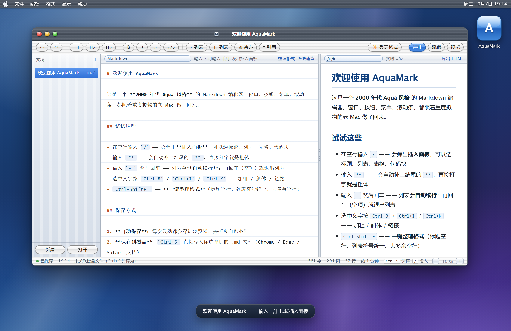
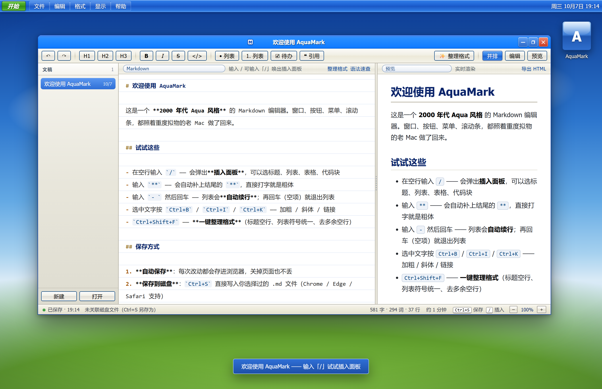
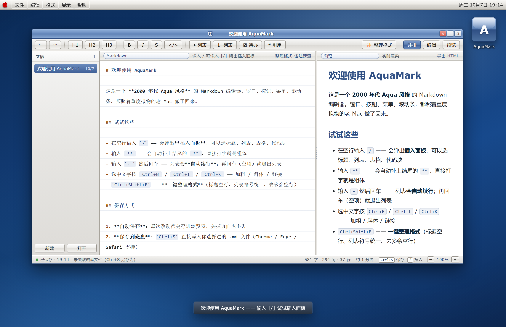
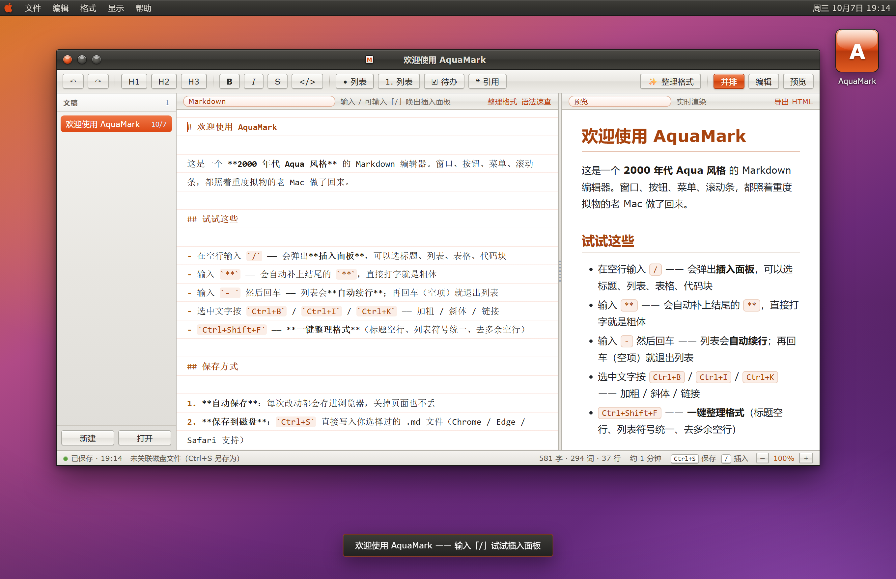
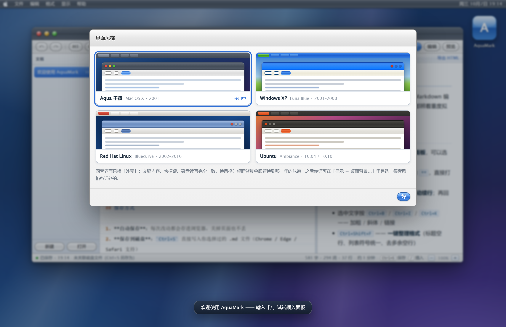

# AquaMark for Windows

> 2000 年代 Aqua 桌面 + Markdown 编辑器。免安装、离线可用、一个文件夹就能带走。

AquaMark 把窗口、按钮、菜单、滚动条都照着重度拟物的老 Mac 做了回来；这个仓库是它的
**Windows 便携版**——不编译、不安装，跑的是系统自带 Edge（或 Chrome）的「应用窗口模式」。

除默认的 Aqua 千禧外，还内置 **4 套年代界面风格**，随时切换：



| Aqua 千禧 · Mac OS X 2001 | Windows XP · Luna Blue 2001–2008 |
| --- | --- |
|  |  |
| **Red Hat Linux · Bluecurve 2002–2010** | **Ubuntu · Ambiance 10.04 / 10.10** |
|  |  |

「显示 → 界面风格…」打开选择面板，四张卡点一下就整套换掉：



> 截图里的文稿是编辑器自带的欢迎页。


## 一、两台机器都能用（Intel 和骁龙都是同一份文件）

这个版本不编译、不安装，跑的是系统自带的 Edge（或 Chrome）的「应用窗口模式」：

- Windows 10 / 11 自带 Edge。
- Intel（x64）机器上跑 x64 版 Edge；骁龙（Windows on ARM）机器上跑 ARM64 原生版 Edge。
  两者都不需要我们操心 —— 本文件夹里没有任何与 CPU 架构有关的东西。
- 所以：把整个文件夹拷到哪台机器上都能直接用，两份拷贝互不影响。

如果你的电脑是公司的、禁用了 PowerShell 脚本或被杀软拦了本地端口，看下面「四、备用方案」。


## 二、怎么用（推荐，三步）

1. 双击 `Create-Shortcut.vbs`
   → 桌面上会出现 AquaMark 快捷方式（图标就是那只千禧 Aqua 的 A）。
2. 以后双击这个快捷方式即可。
   它会：启动一个只监听 `127.0.0.1` 的小服务 → 用 Edge 打开一个没有地址栏、
   没有标签页的独立窗口。服务由页面心跳维持；你关掉窗口后，它会在约
   45 秒内自行退出，不需要手动结束，也不会残留进程。
3. 第一屏是一张「开机卡」，点一下（或按任意键）就进入真正的全屏专注环境。

为什么要那个小服务？见「三」。


## 三、关于「保存」——这是唯一需要知道的一件事

浏览器的磁盘读写权限（File System Access API）只在「安全来源」下发放：
`https`、`localhost`、`127.0.0.1` 给；`file://` 不给。

**A. 用 `Start-AquaMark.bat` 启动（推荐）**

页面跑在 `http://127.0.0.1` 上，权限齐全：

| 快捷键 | 作用 |
| --- | --- |
| `Ctrl+S` | 直接写回你正在编辑的那个 `.md` 文件 |
| `Ctrl+O` | 打开磁盘上的 `.md` |
| `Ctrl+Shift+S` | 另存为 |

第一次在对话框里选过文件之后，后面的 `Ctrl+S` 都是直接覆盖，不再弹窗。

这个服务只绑定 `127.0.0.1`（本机回环），别的电脑访问不到，不需要管理员权限，
也不需要 `netsh` 预留端口。

浏览器是用 `--no-proxy-server` 启动的：即使系统开着 VPN / 代理，也不会把
`127.0.0.1` 的请求送去代理（这是「找不到地址」最常见的原因之一）。

端口范围 `8731–8741`，被占用时自动顺延。

**B. 直接双击 `AquaMark.html`（或 `Ctrl+S` 提示「只读会话」时）**

功能一个不少，但浏览器不允许写回原文件：

| 快捷键 | 行为 |
| --- | --- |
| `Ctrl+S` | 往「下载」文件夹里存一份副本（`说明(1).md`、`说明(2).md`…） |
| `Ctrl+O` | 仍能正常打开 |

状态栏这时会明写着「只读会话：Ctrl+S 会下载副本」。

另外：文稿平时自动存在浏览器自己的存储里（`%LOCALAPPDATA%\AquaMark\Profile`），
关掉页面也不会丢，跟是否关联磁盘文件无关。别去清这个目录。


## 四、备用方案

**`Start-AquaMark-NoServer.bat`** —— 不启任何服务，直接以 `file://` 打开。行为同上文的 B。
公司策略挡了 PowerShell、或防火墙 / 杀软拦本地端口时用它。

两种模式的切换是自动的：推荐脚本若发现服务起不来，会自己降级成 `file://` 打开，
不会卡在那里不动。


## 五、快捷键（Mac 版是 ⌘，Windows 版自动换成 Ctrl）

| 分类 | 按键 |
| --- | --- |
| 文件 | `Ctrl+S` 保存 · `Ctrl+O` 打开 · `Ctrl+N` 新建 · `Ctrl+P` 打印 |
| 文件 | `Ctrl+Shift+S` 另存为 · `Ctrl+R` 从磁盘重读 |
| 编辑 | `Ctrl+Z` / `Ctrl+Shift+Z` 撤销 / 重做 · `Ctrl+F` 查找 |
| 格式 | `Ctrl+B` 加粗 · `Ctrl+I` 斜体 · `Ctrl+K` 链接 · `Ctrl+E` 行内代码 |
| 格式 | `Ctrl+Shift+E` 代码块 · `Ctrl+Alt+U` 删除线 · `Ctrl+1/2/3` 标题层级 |
| 格式 | `Ctrl+Shift+F` 整理格式 |
| 视图 | `Ctrl+` / `Ctrl-` 缩放 · `Ctrl+0` 恢复 100% · `Ctrl+滚轮` 连续缩放 |
| 视图 | `F11` 进入 / 退出全屏（Mac 上是 ⌃⌘F） |

空白处右键：换壁纸 / 换界面风格 / 整理格式 / 窗口复位 / 全屏 / 显示启动幕。

菜单里、工具栏悬浮提示里、帮助面板里的说明都已改成 Windows 写法，不再出现苹果符号。


## 六、界面风格（四套 2000 年代外观，随时换）

| # | 风格 | 年代 | 特征 |
| --- | --- | --- | --- |
| 1 | **Aqua 千禧** | Mac OS X · 2001 | 默认，原来的样子 |
| 2 | **Windows XP** | Luna Blue · 2001–2008 | 蓝色任务栏 + 绿色「开始」，米色工具栏 |
| 3 | **Red Hat Linux** | Bluecurve · 2002–2010 | GNOME 2 灰面板 + 红帽图标 + 金属蓝标题栏 |
| 4 | **Ubuntu** | Ambiance · 10.04 / 10.10 | 炭灰面板 + 橙色强调，窗口按钮在左边 |

换的不只是配色：菜单栏形态、窗口按钮位置（XP / Red Hat 在右、Ubuntu 在左）、
按钮形状（胶囊 / 方圆）、纸张横线、选中色、滚动条、对话框、启动幕，都跟着那一年的语言变。

- 每套风格各自记一张桌面背景：在 Ubuntu 下选了橙紫那张，切回 XP 会自己回到蓝天绿丘，
  再切回 Ubuntu 又是橙紫。壁纸库也按当前风格筛选（共 18 张，新增 XP 蓝天绿丘、
  Red Hat 深蓝、Ubuntu 10.10 紫）。
- 选择会被记住，下次启动还是这套；Aqua 那套和之前完全一样，随时可以切回来。
- 文稿内容、快捷键、磁盘读写、自动补全完全不受影响 —— 换的只是外壳。

> ⚠️ **注意**：本文件夹里的 `AquaMark.html` 若之后用 Mac 源重新跑
> `tools/make_windows_variant.py` 生成，这些主题改动会被覆盖。届时把改动同步回
> Mac 源，或干脆继续用这份 Windows 版为准。


## 七、出问题时（Troubleshooting）

- **双击 bat 一闪而过**：把 `Start-AquaMark.bat` 拖到已打开的 cmd 窗口里回车，看报错。
- **提示被 SmartScreen 阻止**：右键 bat → 属性 → 常规 → 勾选「解除锁定」→ 确定。
- **Edge 说「找不到地址 / 无法访问此网站」**：
  1. 先试 `Start-AquaMark-NoServer.bat`，能打开就说明是本地服务被挡了
     （公司策略、杀软、或系统代理）。
  2. 系统开着代理 / VPN 时，确认 AquaMark 是用 `Start-AquaMark.bat` 打开的
     （已带 `--no-proxy-server`），而不是自己往地址栏里贴网址。
  3. 若仍失败，在 Edge 里访问 `http://127.0.0.1:8731/AquaMark.html` 看具体错误码。
- **所有 `.bat` / `.ps1` 必须用 CRLF 换行**。从 Mac 传过来的文件是 LF，cmd.exe 处理
  带括号代码块和 `goto` 时会出错。仓库里的 `.gitattributes` 已经钉死 `eol=crlf`，
  从 GitHub 克隆回来不会踩到这个坑。
- **端口被别的软件占了**：不用管，脚本会自动换到 `8731–8735` 里的空闲端口。
- **同时开两个 AquaMark**：也会各自拿不同端口，互不影响。
- **杀软报本地端口**：改用 `Start-AquaMark-NoServer.bat`。
- **想重新来过**：删掉 `%LOCALAPPDATA%\AquaMark` 这个文件夹（会丢文稿，谨慎）。


## 八、这份仓库与 Mac 源的关系

`tools/make_windows_variant.py` 的作用是读取 **Mac 源**（根目录的 `AquaMark.html`）
并生成 Windows 版，它期待的是这样的项目结构：

```
AquaMark/                          ← Mac 源仓库根目录
├── AquaMark.html                  ← 唯一真源
└── windows/                       ← 本仓库的内容
    ├── AquaMark.html              ← 由上面那份生成
    └── tools/make_windows_variant.py
```

本仓库目前是 **Windows 版的独立仓库**，不含 Mac 源，所以脚本在这里暂时跑不起来。
把 Mac 源一并纳入后即可继续使用：

```bash
python3 windows/tools/make_windows_variant.py
```

每处替换都带出现次数校验，源码对不上时会明确报错，不会静默生成残缺页面。
（`tools/make_ico.py` 则是从 Mac 的图标里重新导出 `AquaMark.ico`。）

> ⚠️ 本文件夹这份已经装了「界面风格」四套主题（见第六节），重新生成会把它冲掉。


## 九、想要真正的安装版 exe？

当前这套是「免安装便携版」：不用装任何东西、离线可用、两台机器同一份文件。

如果你更想要任务栏固定、原生文件对话框、独立进程的原生安装程序，可以做
（Electron 或 .NET + WebView2 的外壳），代价是要在 Windows 上装工具链，
并且要为 Intel / 骁龙分别出两个包（体积几十到上百 MB）。


## 授权

[MIT License](LICENSE)
